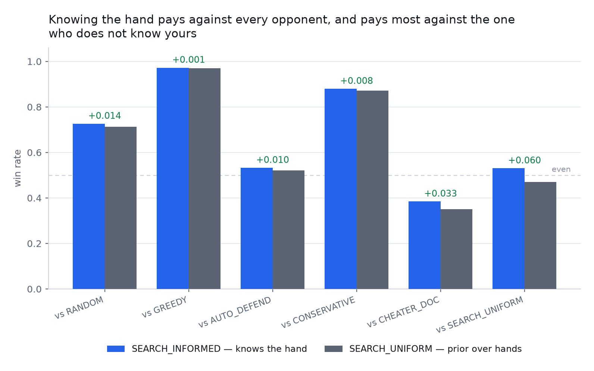
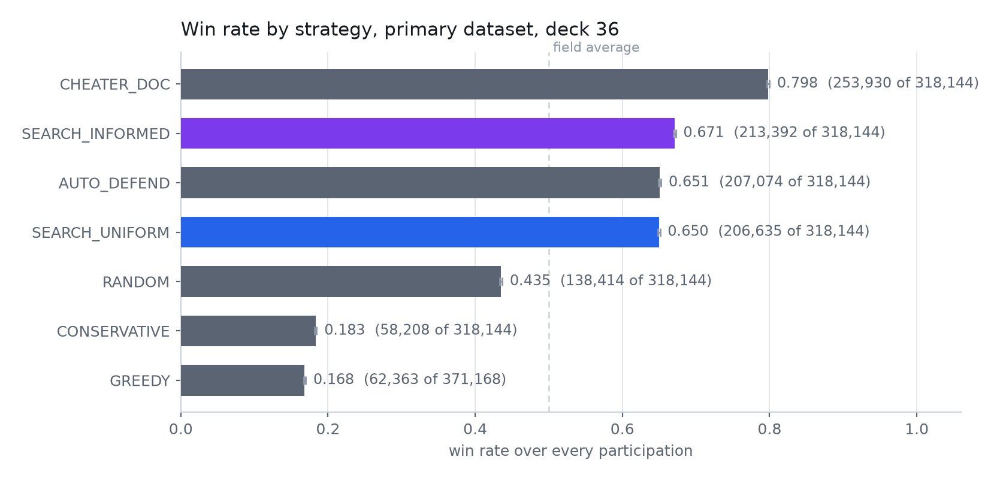
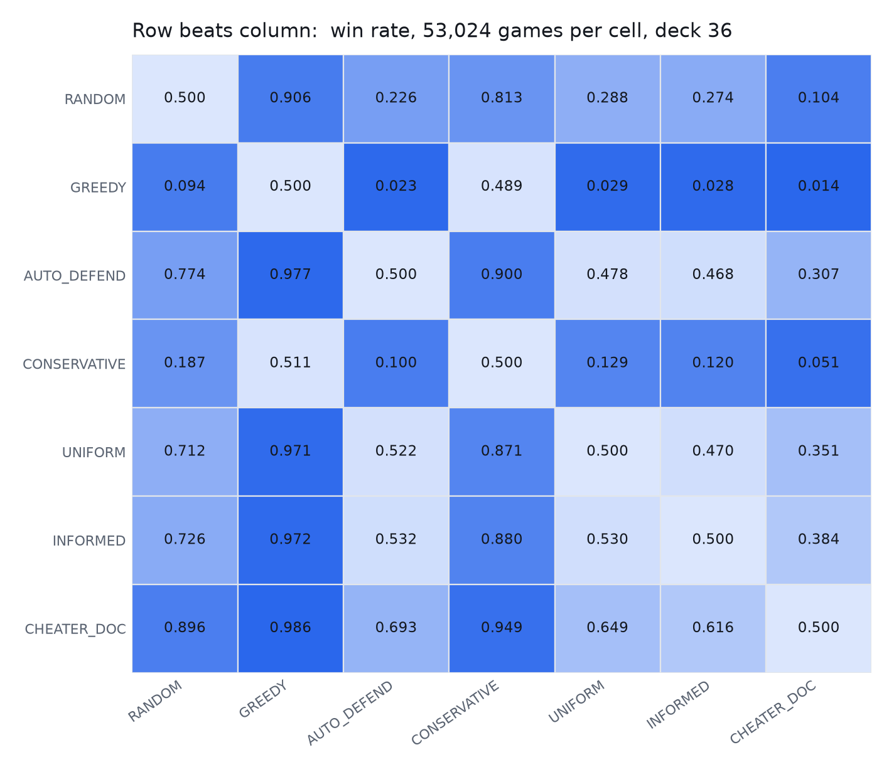
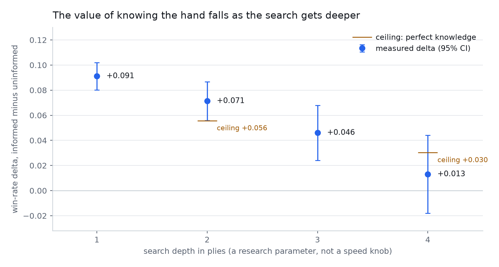
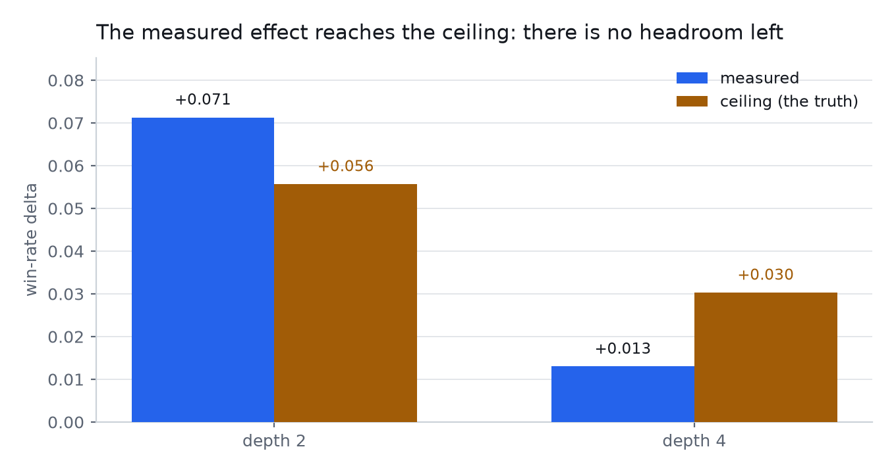
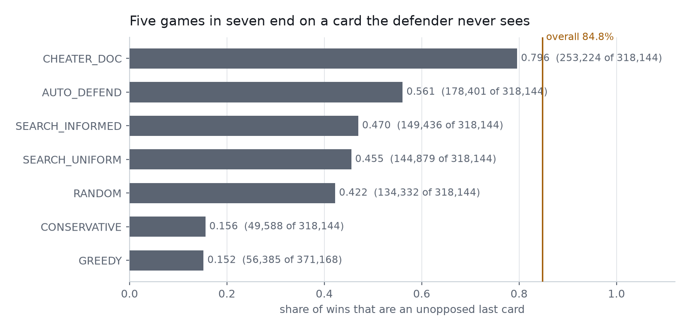
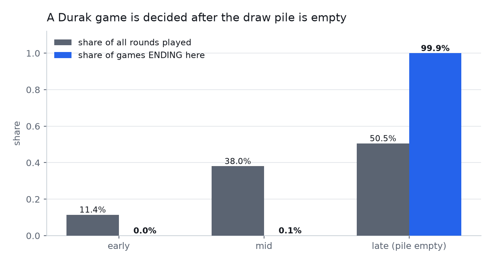
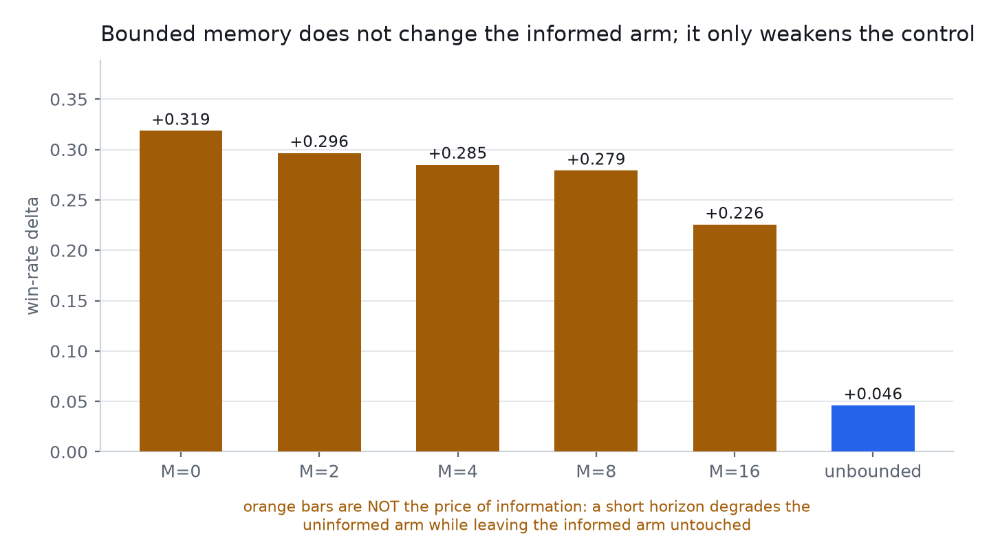

# Durak Information Value — What Knowing the Opponent's Hand Is Worth

> A deterministic simulation of the card game Durak that pits configurable policies against each other in
> full round-robin tournaments, and measures one question with statistical rigour: **how much is perfect
> knowledge of the opponent's hand worth?**

[](tests/)
[](durak/versions.py)
[](durak/versions.py)
[](pyproject.toml)
[](LICENSE)

## Table of Contents

- [What this measures](#what-this-measures)
- [The headline](#the-headline)
- [Tech Stack](#tech-stack)
- [Quick Start](#quick-start)
- [Dataset](#dataset)
- [Exploratory Analysis](#exploratory-analysis)
- [Results](#results)
- [What the Effect Depends On](#what-the-effect-depends-on)
- [Robustness](#robustness)
- [Fork This and Recompute It](#fork-this-and-recompute-it)
- [Testing](#testing)
- [Limitations](#limitations)
- [Recommendations](#recommendations)
- [Project Structure](#project-structure)
- [License](#license)

---

## What this measures

Durak is a shedding game: the player who empties their hand first wins. Two players alternate attacking
and defending, and both may throw extra cards onto a trick when they beat it. That creates a single
genuine hidden variable — **what the opponent is holding** — and that is what this project isolates.

Two search policies are compared, identical in every respect except their belief:

| policy | belief about the opponent's hand |
|---|---|
| `SEARCH_INFORMED` | reads the real hand as a single hypothesis |
| `SEARCH_UNIFORM` | draws 100 hypotheses from the uniform prior over hands consistent with what is visible |

Everything else is shared: the same evaluation weights, the same leaf, the same tie-break, the same seeds.
The difference between their win rates is therefore attributable to the belief and to nothing else.

> [!IMPORTANT]
> The engine **hides the draw pile from the search**. An earlier version let it see the deck, and with the
> deck public the opponent's hand became derivable by complement — the information the experiment measures
> was not hidden at all. Every number here is from the corrected model.

## The headline



**Knowing the opponent's hand is worth +6.03 win-rate points** (95% CI [+0.0518, +0.0688]; 28,110 wins
against 24,914 in 53,024 paired games; McNemar p = 8.5e-44). But that number is the *whole-field* average
of a comparison against one opponent. Broken out against each:

| opponent | gap between informed and uninformed |
|---|---|
| `SEARCH_UNIFORM` | **+0.060** |
| `CHEATER_DOC` | +0.033 |
| `RANDOM` | +0.014 |
| `AUTO_DEFEND` | +0.010 |
| `CONSERVATIVE` | +0.008 |
| `GREEDY` | +0.001 |

Knowing the hand pays against every opponent. It pays **six times more against an opponent who does not
know yours** than against a heuristic that knows nothing about you at all. The value of information is
concentrated in asymmetry, not in the knowledge itself.

> [!NOTE]
> This conclusion was wrong in an earlier draft of this README. The matchup matrix stores one row per
> unordered pair, and the first reading took `win_rate_a` without checking which strategy `strategy_a` was.
> Reading it the other way round inverts every gap. The table above is the corrected orientation, verified
> against the marginal rates in [Exploratory Analysis](#exploratory-analysis).

## Tech Stack

| layer | choice | why |
|---|---|---|
| engine | Python + Numba `@njit` | 1.14M games in 50 minutes on 8 cores; the search is compiled, not interpreted |
| storage | Parquet via PyArrow | three levels of telemetry in one dataset, partitioned by run and deck |
| analysis | DuckDB | the aggregates are SQL over the Parquet, so every published number is re-derivable |
| statistics | paired bootstrap, McNemar exact, Wilson | intervals on rates, a test on the paired discordance |
| reports | Matplotlib PNG + zero-dependency HTML | no CDN, no web fonts, no external runtime |
| tests | pytest | 493 tests |

## Quick Start

```bash
python -m venv .venv && .venv/bin/pip install -e .
.venv/bin/python -m pytest                    # 493 tests, ~4 minutes
```

Reproduce the published aggregates and every figure:

```bash
# ~50 minutes on 8 cores: 1,140,016 games, deck 36
DATASET_NAME=primary DATASET_GAMES_PER_PAIRING=26512 DATASET_DECKS=36 \
  .venv/bin/python _dataset.py

.venv/bin/python -c "from analysis.queries import build_all; \
  build_all('datasets/primary', 'analysis/data', deck_size=36)"

.venv/bin/python -c "from reports.figures import build_figures; \
  build_figures('analysis/data', 'assets/figures')"
```

## Dataset

| | |
|---|---|
| design | full round-robin over 7 policies, **both seat orders of every pairing** |
| games per cell | 53,024 (26,512 per direction) |
| total | **1,140,016** games on deck 36, plus the same count on deck 52 |
| seed | fixed; a game's seed derives from `(run_seed, pairing_index, game_index)` and nothing else, so a block is reproducible whatever order it runs in |
| telemetry | level 1 per game, level 2 per round, level 3 per sampled move |
| anomalies | **0** across 1,140,016 games: no card-conservation violation, no illegal move, no redeal overflow, no round-cap hit, no undecided game |

> [!WARNING]
> `AUTO_ATTACK` — a driver that never defends — is **refused by the runner** in any tournament. Pooled
> into a descriptive statistic it supplied 24.6% of games and nearly tripled the mean loser's final hand,
> so the statistic described the driver rather than the game. It remains registered for the invariant
> suites, which need a trivial engine driver.

## Exploratory Analysis



The frozen evaluation vector turns the search arms from the weakest in the field into the second strongest,
ahead of `AUTO_DEFEND` and `RANDOM` by a wide margin. `CHEATER_DOC` — which is given the opponent's hand
on every turn — still leads at 0.798, which is the ceiling this project is working against.



Each cell is one unordered pair with both seat orders folded in, so **no rate moves when the policy palette
changes**. That is why this matrix, and not the marginal rates above, is the metric to quote across studies.

> [!TIP]
> `RANDOM` beats both search arms only 28% of the time, and `GREEDY` wins 2.9%. Against a heuristic that
> knows nothing, the informed search wins essentially every game. The information margin is not the same
> thing as the strength margin, and the two are reported separately throughout.

## Results

### 1. The value of knowledge falls as the search deepens



| search depth | delta | 95% CI | informed vs `GREEDY` |
|---|---|---|---|
| 1 ply | **+0.0911** | [+0.0802, +0.1020] | 0.460 |
| 2 plies | **+0.0713** | [+0.0558, +0.0867] | 0.538 |
| 3 plies | **+0.0460** | [+0.0241, +0.0679] | 0.534 |
| 4 plies | +0.0130 | [−0.0180, +0.0440] | 0.522 |

The arms get *stronger* with depth (0.460 → 0.538 against `GREEDY`) and the value of knowing the hand gets
*smaller* (+0.091 → +0.013). Depth is a research parameter here, not a performance knob, and every number
in this project is stated next to it.

### 2. There is no headroom left above the measured effect



An oracle arm reads the opponent's hand exactly, and its uninformed mirror draws from the same prior. Both
sit at the depth being bounded, so the gap between them is the most perfect knowledge of the hand could
possibly be worth.

| depth | measured | ceiling |
|---|---|---|
| 2 | +0.0713 | +0.0557 |
| 4 | +0.0130 | +0.0303 |

The measured delta and the ceiling are **statistically indistinguishable at both depths**. The oracle also
ties the informed arm to within −0.0007, which is the consistency check the whole construction rests on: the
oracle adds nothing the informed arm does not already have, because that arm already has the truth.

> [!NOTE]
> A ceiling is only a ceiling if both arms sit at the depth being bounded. Comparing a depth-4 ceiling
> against a depth-2 measurement would confound "does knowledge pay" with "does depth pay", and in this engine
> those two point in opposite directions.

### 3. Five games in seven end on a card nobody can answer



The win check runs before the defender responds, so an attack with the last card ends the game unanswered.
That is the documented rule set, not a defect — but it means **84.8% of all games are settled by a card the
loser never saw**, which compresses the decisive phase of the game into a single ply.

### 4. A Durak game is decided after the draw pile is empty



50.5% of all rounds are played in the late phase with a mean of 0.9 cards left in the pile, and **2,278,820
of 2,280,032 games end there — 99.95%**. The opening is nearly irrelevant; the game is decided once nobody
can draw.

## What the Effect Depends On

### The evaluator moves the result more than the information does

Twelve evaluation-weight vectors were measured against a fixed panel, 10,000 games per opponent. Their
panel strength spans **0.148 to 0.688 — a factor of 4.7** — and the recorded delta ranges from −0.036 to
+0.061 across the same twelve. Selecting on strength and not on the headline moved the project's headline
from +0.060 under the first frozen vector to a *smaller* number under a stronger one.

> [!WARNING]
> A stronger evaluation therefore produced a **smaller** headline. That is the selection rule working, and
> it is the single most important methodological point in this repository: tuning weights until the
> headline grows fits the answer to the question.

### Bounded memory does not change the informed arm



A short memory horizon degrades the **uninformed** arm and leaves the informed one untouched, because the
informed arm reads the hand directly rather than inferring it. The finite-`M` deltas therefore measure the
degradation of the control, not the price of information.

> [!IMPORTANT]
> Only the unbounded reading is a price of information. Reporting the `M=0` figure (+0.3185) as one would be
> reporting that the uninformed arm was crippled.

### The deal does not matter

Stratified on the trump count in the **opening deal** — fixed before any card is played, so it cannot be an
effect of either policy — the delta is flat: every bucket with usable volume sits between +0.044 and +0.079,
with intervals that all contain roughly +0.06. Neither trump abundance nor hand homogeneity is detectable.

Deck 36 gives +0.0603 [+0.0518, +0.0688]; deck 52, never played before this project, gives +0.0562
[+0.0477, +0.0647]. The effect is a property of the game, not of one deck.

## Robustness

| check | result |
|---|---|
| seeds | 5 independent runs: +0.034, +0.046, +0.053, +0.069, +0.075 — **all positive, none crossing zero** |
| instrument gates | 16 gates run before a measurement is used; two were found to be testing the wrong thing and fixed |
| data quality | 0 anomalies in 1,140,016 games |
| pool stability | every figure from a process pool is gated: 1 worker and 8 must return identical win counts |
| effective resolution | the search averages **78.9 distinct hypotheses per decision** out of a nominal 100 |

## Fork This and Recompute It

The most useful thing a reader can do with this repository is re-measure the conclusion.

> [!TIP]
> **A stronger evaluation vector already exists and is deliberately not adopted.** The weight vector
> `(3.0, 2.0, 0.5, 0.3, 0.5)` beats the frozen `(3.0, 2.0, 0.5, 0.3, 1.5)` on panel strength by 0.0122 —
> roughly two to three sigma at 10,000 games per opponent on one seed. It was **not** adopted because
> adopting it means every number in this README describes a different instrument from the one the code
> defaults to, and re-measuring all of it was declined.

To try it yourself:

```bash
# 1. Re-freeze the instrument
sed -i 's/SELECTED_WEIGHTS = (3.0, 2.0, 0.5, 0.3, 1.5)/SELECTED_WEIGHTS = (3.0, 2.0, 0.5, 0.3, 0.5)/' \
    durak/evaluation.py

# 2. Re-measure everything, ~50 minutes
rm -rf datasets/primary durak/__pycache__ durak/strategies/__pycache__
DATASET_NAME=primary DATASET_GAMES_PER_PAIRING=26512 DATASET_DECKS=36 \
  .venv/bin/python _dataset.py

# 3. Rebuild aggregates and figures
.venv/bin/python -c "from analysis.queries import build_all; \
  build_all('datasets/primary', 'analysis/data', deck_size=36)"
.venv/bin/python -c "from reports.figures import build_figures; \
  build_figures('analysis/data', 'assets/figures')"
```

Compare `analysis/data/price_of_information.json` before and after. A headline near +0.046 rather than
+0.060 is the expected result, and would confirm that the selection rule is doing what it claims.

## Testing

```bash
.venv/bin/python -m pytest          # 493 tests, ~4 minutes
```

The suite is not a formality. It holds the properties that produced five confident wrong answers during
development: that a run's seat order cannot cancel itself, that two workers and one worker play the same
games, that a figure follows its data, that a stale numba cache cannot masquerade as a changed parameter,
and that a level-2 row identifies exactly one game.

## Limitations

> [!WARNING]
> **The reported effect is measured with an evaluation vector that a later sweep showed to be beatable by
> roughly two sigma.** The stronger vector was not adopted because every published number would then
> describe a different instrument. This is stated rather than resolved.

- **Depth is capped at 4.** Depth 5 would cost about twenty-five times depth 1 and was removed from the
  research entirely rather than deferred.
- **The particle count cannot be varied.** It is a compiled constant, so nothing here supports a claim
  about it in either direction.
- **Per-phase attribution is inadmissible, not merely unmeasured.** Every phase variable is produced by the
  policies' own actions, so conditioning the delta on it selects on the treatment. "When in a game does
  information pay" is structurally unanswerable with a paired outcome per game.
- **No mechanism is attached to the trump curve.** Whether trumps matter through hand homogeneity or
  through the trump hierarchy is untested. The curve is reported; the cause is not.
- **One seed per configuration** for the depth curve and the ceilings. Five seeds were run for the headline
  only.
- **A withdrawn headline exists.** An earlier figure of +0.0799 was measured before the draw pile was hidden
  and is not reproducible. It must not be cited.

## Recommendations

- **Depth 2 is the operating point to publish from.** Depth 1 shows the largest effect but the weakest arms;
  depth 4 shows the strongest arms and an interval crossing zero.
- **Treat the evaluator as the dominant lever.** A 4.7× spread in policy strength from weights alone is
  larger than anything information contributes. Any future work should tune evaluation before it adds depth.
- **Do not quote a single number for this effect.** It is a function of depth (+0.091 to +0.013), of the
  evaluation vector (−0.036 to +0.061 across twelve), and of the comparison. The range is the finding.
- **Re-freeze onto the stronger vector** if a second phase of this project has the compute; the comparison
  is scripted above.

## Project Structure

```
durak/            engine, rules, search, telemetry, strategies
analysis/         DuckDB queries over Parquet; run-transcript aggregation
reports/          figure rendering and the HTML pages
tests/            493 tests
docs/             research plan, hypotheses, run catalogue, experiment log
assets/figures/   committed PNGs, byte-reproducible across renders
results/          run transcripts, gitignored
datasets/         generated datasets, gitignored
```

## License

MIT.